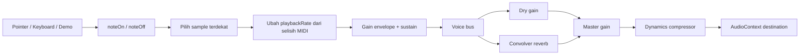

# GRAND / 88

[](https://ikyletwar.github.io/grand-piano-88/)
[](#arsitektur-teknis)
[](CREDITS.md)
[](#mode-offline--pwa)
[](#instrumen)

> **Piano grand 88 tuts di browser.** Rekaman Yamaha C5 nyata, sustain pedal, peta keyboard `Q`–`M` dengan `Shift` untuk tuts hitam, tampilan case piano realistis, dan mode offline penuh. Tanpa build step, tanpa framework, tanpa API, tanpa analytics.

**[Buka versi live](https://ikyletwar.github.io/grand-piano-88/)** · **[Repository](https://github.com/Ikyletwar/grand-piano-88)** · **[Kredit audio](CREDITS.md)**

---

## Daftar isi

- [Ringkasan](#ringkasan)
- [Fitur utama](#fitur-utama)
- [Demo & akses](#demo--akses)
- [Mulai cepat](#mulai-cepat)
- [Peta keyboard lengkap](#peta-keyboard-lengkap)
- [Kontrol lengkap](#kontrol-lengkap)
- [Arsitektur teknis](#arsitektur-teknis)
- [Mesin audio](#mesin-audio)
- [Mode offline & PWA](#mode-offline--pwa)
- [Struktur proyek](#struktur-proyek)
- [Responsivitas](#responsivitas)
- [Aksesibilitas](#aksesibilitas)
- [Performa](#performa)
- [Kompatibilitas browser](#kompatibilitas-browser)
- [Deployment](#deployment)
- [Pemecahan masalah](#pemecahan-masalah)
- [Lisensi & atribusi](#lisensi--atribusi)
- [Riwayat versi](#riwayat-versi)

---

## Ringkasan

Proyek ini adalah static web app yang mengubah browser menjadi piano grand 88 tuts. Seluruh suara berasal dari sampel **Salamander Grand Piano**, rek grand piano Yamaha C5 yang direkam dengan dua mikrofon AKG C414 dan dirilis oleh Alexander Holm di bawah lisensi **CC BY 3.0**.

Tiga prinsip desain yang dipakai:

1. **Suara nyata, bukan synth.** Tidak ada oscillator piano tiruan. 30 file MP3 asli dimuat dan dipetakan ke 88 pitch memakai `AudioBufferSourceNode.playbackRate`.
2. **Kontrol yang terasa seperti instrumen.** Sustain, velocity berdasarkan posisi klik, reverb ringan, dan respons tuts yang langsung.
3. **Tidak bergantung pada layanan eksternal saat dipakai.** Mirror sample ada di repo, service worker menyimpan semuanya, dan CDN hanya menjadi cadangan.

---

## Fitur utama

### Instrumen

- **88 tuts penuh**, A0 sampai C8 — 52 tuts putih dan 36 tuts hitam.
- **Sampel grand piano asli**: Salamander Grand Piano, Yamaha C5, CC BY 3.0.
- **Sustain pedal** lewat tombol UI atau `Space`. Saat pedal ditekan, release diperpanjang dari 240 ms menjadi 1,8 s.
- **Velocity dinamis**: klik dekat ujung bawah tuts menghasilkan serangan lebih keras, klik dekat pangkal lebih pelan.
- **Reverb prosedural** berbasis impulse response yang dibangkitkan di runtime — tidak ada file audio tambahan.
- **Demo bawaan**: frasa pembuka *Für Elise* diikuti arpeggio A minor, dengan pedal otomatis.

### Interaksi

- **Peta keyboard `Q`–`M`** berurutan dari tuts putih paling kiri ke kanan.
- **`Shift` + huruf** memainkan tuts hitam yang bersesuaian.
- **Glissando**: tekan dan geser pointer melintasi tuts; nada sebelumnya dilepas, nada baru dipicu.
- **Multi-touch**: setiap pointer ID dipantau terpisah, sehingga chord sentuh beberapa jari berfungsi.
- **Tiga mode tampilan**: 88 tuts penuh, 24 tuts, dan 12 tuts.
- **Octave shift** untuk memindahkan peta keyboard satu oktaf per langkah.
- **Label not opsional**, termasuk chip shortcut langsung di tuts.

### Infrastruktur

- **Static site murni**: `index.html`, `styles.css`, `app.js`, `sw.js`.
- **Offline-ready** lewat service worker dengan 35 entri cache.
- **CDN fallback** ke `tonejs.github.io` dan `jsdelivr` bila mirror lokal gagal.
- **Aksesibilitas**: skip link, focus ring, `aria-keyshortcuts`, `aria-describedby`, `prefers-reduced-motion`.
- **Lighthouse**: Accessibility 1,00 · Best Practices 1,00 · SEO 1,00 · 0 failure.

---

## Demo & akses

| Kebutuhan | Lokasi |
|---|---|
| Versi live | <https://ikyletwar.github.io/grand-piano-88/> |
| Source code | <https://github.com/Ikyletwar/grand-piano-88> |
| Kredit & lisensi audio | [`CREDITS.md`](CREDITS.md) |
| Panduan keyboard di aplikasi | Tombol `?` di header, atau tekan `?` |

Halaman GitHub Pages sudah aktif dari branch `main`, path `/`, dengan HTTPS enforced.

---

## Mulai cepat

Tidak ada instalasi dependency. Satu-satunya kebutuhan adalah browser modern dan server statis lokal.

```bash
git clone https://github.com/Ikyletwar/grand-piano-88.git
cd grand-piano-88
python3 -m http.server 8080
```

Buka <http://localhost:8080>.

Alternatif bila Python tidak tersedia:

```bash
npx serve .
# atau
php -S localhost:8080
```

> **Catatan penting:** membuka `index.html` langsung lewat `file://` tetap bisa memainkan piano, tetapi browser memblokir `fetch` ke file MP3 lokal. Aplikasi lalu memakai CDN dan memerlukan internet. Untuk offline penuh, pakai server lokal atau GitHub Pages setelah kunjungan pertama.

---

## Peta keyboard lengkap

Urutan huruf mengikuti posisi fisik keyboard: `Q` di kiri atas, berlanjut ke `P`, turun ke `A`–`L`, lalu `Z`–`M`. `Q` adalah tuts putih paling kiri dalam peta aktif; `M` adalah tuts putih paling kanan dalam peta aktif.

### Peta default — mulai C3

```text
Putih : Q  W  E  R  T  Y  U  I  O  P  A  S  D  F  G  H  J  K  L  Z  X  C  V  B  N  M
Not   : C3 D3 E3 F3 G3 A3 B3 C4 D4 E4 F4 G4 A4 B4 C5 D5 E5 F5 G5 A5 B5 C6 D6 E6 F6 G6
Hitam : ⇧Q ⇧E ⇧R ⇧T ⇧U ⇧I ⇧P ⇧A ⇧S ⇧F ⇧G ⇧J ⇧K ⇧L ⇧X ⇧C ⇧B ⇧N ⇧M
Not   : C#3 D#3 F#3 G#3 A#3 C#4 D#4 F#4 G#4 A#4 C#5 D#5 F#5 G#5 A#5 C#6 D#6 F#6 G#6
```

`⇧` berarti tahan `Shift` sebelum menekan huruf.

### Aturan tuts hitam

- Untuk `C`, `D`, `F`, `G`, `A`: `Shift + huruf` memainkan tuts hitam **di sebelah kanan**.
- Untuk `E` dan `B`: tidak ada tuts hitam di kanan, maka yang dipakai adalah tuts hitam **di sebelah kiri** (`D#` / `A#`).
- Beberapa tuts hitam bisa dipicu oleh dua huruf `Shift` berbeda. Contoh: `Shift+W` dan `Shift+E` sama-sama menghasilkan `D#3`; chip di tuts menampilkan huruf yang unik, tetapi kedua kombinasi tetap berfungsi.

### Octave shift

Tombol `−` / `=` atau tombol di toolbar menggeser awal peta satu oktaf. Rentang awal yang didukung: `C1`–`C4`.

| Awal peta | `Q` | `M` |
|---|---|---|
| C1 | C1 · MIDI 24 | G4 · MIDI 67 |
| C2 | C2 · MIDI 36 | G5 · MIDI 79 |
| **C3 — default** | **C3 · MIDI 48** | **G6 · MIDI 91** |
| C4 | C4 · MIDI 60 | G7 · MIDI 103 |

Saat awal peta digeser, chip shortcut dan label di tuts ikut diperbarui.

---

## Kontrol lengkap

| Aksi | Input | Perilaku |
|---|---|---|
| Mainkan tuts putih | `Q` … `M` | Pitch naik berurutan ke kanan |
| Mainkan tuts hitam | `Shift` + huruf | Memetakan ke tuts hitam terdekat |
| Sustain | `Space` atau tombol Sustain | Tahan untuk menahan semua nada yang dilepas |
| Velocity | Posisi klik pada tuts | Pangkal ≈ 0,48 · ujung bawah ≈ 1,00 |
| Glissando | `pointerdown` + `pointermove` | Nada lama dilepas, nada baru dipicu |
| Multi-touch | Beberapa jari sekaligus | Tiap pointer ID memiliki voice sendiri |
| Geser peta oktaf | `−` / `=` | Satu oktaf per langkah |
| Label not | `` ` `` atau toggle Label not | Tampilkan/sembunyikan nama not + shortcut |
| Reverb | toggle Reverb | Mengubah wet gain 0 ↔ 0,13 |
| Volume | slider Volume | Master gain 0–90 % |
| Navigasi tuts | Fokus area piano + `←` / `→` | Memindahkan tuts yang difokuskan |
| Mainkan tuts fokus | `Enter` | Attack saat ditekan, release saat dilepas |
| Tampilan | 88 / 24 / 12 | Mengubah jumlah tuts yang dirender |
| Demo | tombol Putar demo | Memutar frasa; klik lagi untuk menghentikan |
| Panduan | `?` atau tombol `?` | Membuka panel bantuan |

---

## Arsitektur teknis



### Komponen

| File | Tanggung jawab |
|---|---|
| `index.html` | Struktur semantik, toolbar, panel bantuan, footer atribusi |
| `styles.css` | Case kayu, tuts gading/hitam, state aktif, layout responsif, reduced-motion |
| `app.js` | Loader sample, Web Audio graph, input engine, voice manager, demo |
| `sw.js` | Precache + cache-first untuk aset same-origin |
| `samples/` | 30 file MP3 Salamander Grand Piano |

Tidak ada bundler, tidak ada framework, tidak ada library audio pihak ketiga. Seluruh logika berjalan di browser.

---

## Mesin audio

### Pemetaan sample

Salamander Grand Piano yang didistribusikan oleh proyek Tone.js berisi 30 sample MP3: `A0`–`A7`, `C1`–`C8`, `Ds1`–`Ds7`, dan `Fs1`–`Fs7`. Sampel-sampel ini diambil pada interval minor third/oktaf.

Untuk setiap MIDI note 21–108, aplikasi memilih sample dengan jarak pitch terdekat lalu menghitung:

```text
playbackRate = 2 ^ ((MIDI_target - MIDI_sample) / 12)
```

Selisih maksimal ke sample terdekat adalah ±1,5 semitone, sehingga perubahan pitch tetap terdengar alami tanpa stretching ekstrem.

### Envelope dan voice

| Parameter | Nilai |
|---|---|
| Attack | 6 ms, exponential ramp dari 0,0001 ke peak |
| Peak gain | `velocity ^ 1,25 × 0,95` |
| Release tanpa pedal | 240 ms |
| Release dengan pedal | 1,8 s |
| Retrigger | Voice lama di-release 50 ms sebelum voice baru |
| Dry gain | 0,96 |
| Wet gain | 0,13 saat reverb aktif |
| Master gain | `volume / 100 × 0,9` |
| Compressor | threshold −14 dB, knee 18, ratio 3, attack 4 ms, release 200 ms |

> **Detail tentang dinamika:** Salamander asli memiliki 16 velocity layer. Distribusi MP3 yang dipakai di sini menyediakan satu layer per pitch, sehingga velocity mengontrol gain, bukan pergantian layer sample. Ini trade-off yang disengaja agar total aset tetap ~2 MB dan siap dipakai di web.

### Reverb

Impulse response dibangkitkan saat audio graph dibuat: dua kanal noise dengan peluruhan eksponensial `decay = 2,8` selama 1,7 detik. Tidak ada file IR dari luar.

### Autoplay policy

`AudioContext` dibuat saat halaman dimuat, tetapi statusnya bisa `suspended`. Setiap interaksi pertama — klik tuts, tombol, atau keyboard — memanggil `resume()`. Ini mengikuti kebijakan autoplay browser tanpa perlu prompt tambahan.

---

## Mode offline & PWA

Service worker `sw.js` memakai cache `grand-piano-88-v2` dan melakukan precache terhadap:

- `./` dan `./index.html`
- `styles.css`
- `app.js`
- `sw.js`
- 30 file MP3 di `samples/`

Total **35 entri cache**. Strateginya:

1. **Cache-first** untuk semua request GET same-origin, termasuk request `HEAD` berkat `ignoreMethod: true`.
2. **Network fallback**: bila tidak ada di cache, request diteruskan ke jaringan dan respons sukses disimpan.
3. **Cross-origin dilewati**: CDN tidak dicache oleh service worker; browsers cache bawaan tetap berlaku.
4. **Navigasi offline**: bila request mode `navigate` gagal, aplikasi mengembalikan `index.html` dari cache.

Saat status offline, label di header berubah menjadi `Siap · 30 sample · offline`.

### Perilaku berdasarkan cara akses

| Cara akses | Offline penuh? | Penjelasan |
|---|---|---|
| `http://localhost` lewat server statis | Ya | Semua file dibaca langsung dari disk |
| GitHub Pages setelah kunjungan pertama | Ya | Service worker sudah mengisi cache |
| GitHub Pages kunjungan pertama tanpa internet | Tidak | Perlu mengunduh HTML/JS/sample sekali |
| `file://` langsung | Tidak | `fetch` ke file lokal diblokir; CDN dipakai |

Untuk memperbarui cache setelah perubahan kode, naikkan versi `CACHE_NAME` di `sw.js`. Versi lama otomatis dihapus saat service worker baru aktif.

---

## Struktur proyek

```text
grand-piano-88/
├── index.html      # Markup, kontrol, panel bantuan, atribusi footer
├── styles.css      # Case piano, geometri tuts, state interaksi, responsivitas
├── app.js          # Audio engine, voice manager, input, demo, SW registration
├── sw.js           # Precache 35 aset + strategi cache-first
├── samples/        # 30 MP3 Salamander Grand Piano (~2,0 MB)
│   ├── A0.mp3 … A7.mp3
│   ├── C1.mp3 … C8.mp3
│   ├── Ds1.mp3 … Ds7.mp3
│   └── Fs1.mp3 … Fs7.mp3
├── README.md       # Dokumentasi ini
└── CREDITS.md      # Atribusi dan lisensi audio
```

---

## Responsivitas

| Breakpoint | Perilaku |
|---|---|
| ≥ 900 px | Tampilan default 88 tuts; case piano penuh; tinggi tuts ~240–300 px |
| 720–899 px | 88 tuts tetap aktif; slider posisi muncul bila konten melebihi lebar |
| < 720 px | Default 24 tuts agar tuts cukup besar untuk sentuhan |
| ≤ 620 px | Toolbar wrap, case padding dipangkas, tinggi tuts 208 px, label diperkecil |

Mode 88 pada layar sempit tetap tersedia. Karena area tuts memakai `touch-action: none` untuk glissando, navigasi horizontal memakai slider **Posisi tuts** di bawah case, bukan swipe pada tuts.

Tidak ada horizontal overflow pada 390 px, 768 px, maupun 1024 px saat diuji.

---

## Aksesibilitas

- `skip-link` ke area piano untuk keyboard user.
- Tombol memakai elemen `<button>` semantik dengan nama aksesibel; ikon `?`, `−`, dan `+` dibuat via CSS agar tidak bentrok dengan `aria-label`.
- Setiap tuts memiliki `aria-keyshortcuts` yang sesuai, misalnya `Q` atau `Shift+M`.
- Area piano memiliki `aria-describedby` yang merujuk ke teks panduan.
- `:focus-visible` memberi outline aksen pada semua elemen interaktif.
- Panel bantuan memakai `aria-expanded` dan `aria-controls`.
- `prefers-reduced-motion` menonaktifkan transisi dan transform tuts yang ditekan.
- Kontras teks mengikuti palet gelap dengan aksen hangat; Lighthouse accessibility = 1,00.

---

## Performa

| Metrik | Nilai |
|---|---|
| Ukuran sample | ~2,0 MB untuk 30 MP3 |
| Request saat load | 30 GET sample + aset inti |
| Parallel loader | 6 worker konkuren |
| Request HEAD | 0 — fallback per file langsung ke CDN |
| Aset visual | CSS gradient; tidak ada gambar dekoratif |
| Animasi | `transform` dan `opacity` saja; tidak ada layout thrash |
| Setelah cache | 0 request jaringan untuk aset same-origin |

Sample dimuat semua saat startup agar tidak ada latency pada tuts pertama. Status progress ditampilkan di header hingga `Siap · 30 sample`.

---

## Kompatibilitas browser

| Browser | Status | Catatan |
|---|---|---|
| Chrome / Chromium | Didukung | Web Audio + service worker penuh |
| Edge | Didukung | Berbasis Chromium |
| Firefox | Didukung | Web Audio + service worker penuh |
| Safari macOS | Didukung | `AudioContext.resume()` dipanggil pada gesture pertama |
| Safari iOS | Didukung | Mode 24 tuts default; geser memakai slider posisi |
| `file://` | Terbatas | Sample lokal diblokir; CDN dipakai |

Service worker hanya aktif di `https://` atau `localhost`, sesuai spesifikasi web.

---

## Deployment

Proyek ini sudah di-deploy ke GitHub Pages:

```text
Repository : Ikyletwar/grand-piano-88
Branch     : main
Path       : /
Build type : legacy
URL        : https://ikyletwar.github.io/grand-piano-88/
```

Untuk deploy ulang:

```bash
git add .
git commit -m "Deskripsi perubahan"
git push origin main
```

GitHub Pages akan membangun ulang otomatis. Bila memakai custom domain, tambahkan file `CNAME` di root repo lalu set domain di **Settings → Pages**.

---

## Pemecahan masalah

| Gejala | Penyebab | Solusi |
|---|---|---|
| Tidak ada suara | `AudioContext` masih `suspended` | Klik tuts atau tombol apa pun; konteks akan di-resume |
| Status `Sample tidak dapat diakses` | Mirror lokal dan CDN gagal | Cek koneksi, lalu tombol **Coba lagi** |
| Status macet di `Memuat sample …` | Jaringan lambat saat first load | Tunggu; 30 file diunduh paralel |
| Keyboard tidak merespons | Fokus berada di slider/input | Klik area kosong atau area piano dulu |
| `Space` mengaktifkan tombol, bukan sustain | Fokus berada di tombol lain | Klik area piano atau tombol Sustain |
| Tuts ke-25 tidak tampil di mode 24 | Peta 26 huruf lebih panjang dari tampilan | Pakai mode 88, atau geser peta dengan `−` / `=` |
| Mode 88 sulit digeser di HP | Sentuhan pada tuts dipakai untuk glissando | Pakai slider **Posisi tuts** |
| Offline tidak berfungsi di `file://` | Browser memblokir fetch file lokal | Pakai server lokal atau GitHub Pages |
| Cache tidak berubah setelah update | Versi cache lama masih aktif | Naikkan `CACHE_NAME` di `sw.js` |

---

## Lisensi & atribusi

### Audio

- Instrumen: **Salamander Grand Piano V3**, Yamaha C5.
- Rekaman: **Alexander Holm**.
- Sumber: <https://freepats.zenvoid.org/Piano/acoustic-grand-piano.html>
- Lisensi: [Creative Commons Attribution 3.0 Unported](https://creativecommons.org/licenses/by/3.0/)
- Distribusi MP3: <https://github.com/Tonejs/audio/tree/master/salamander>

Atribusi ini wajib dipertahankan sesuai CC BY 3.0 dan sudah tampil di footer aplikasi serta di [`CREDITS.md`](CREDITS.md).

### Kode

Kode aplikasi ditulis khusus untuk repository ini dan tidak mengimpor library audio pihak ketiga. Belum ada lisensi kode eksplisit yang ditetapkan; seluruh hak atas kode melekat pada pemilik repository.

---

## Riwayat versi

| Versi | Perubahan |
|---|---|
| 1.0.0 | Build awal: 88 tuts, 30 sample Salamander, sustain, reverb, demo, mode tampilan 88/24/12 |
| 1.1.0 | Peta keyboard diganti ke urutan `Q`–`M`; `Shift` untuk tuts hitam; toggle label dipindah ke backtick |
| 1.2.0 | Service worker, precache 35 aset, offline penuh, status offline, fallback CDN tanpa request HEAD |
| 1.2.1 | Perbaikan aksesibilitas nama aksesibel dan README dokumentasi lengkap |

---

Dibuat sebagai static web instrument: cepat, dapat diprediksi, dan tetap berfungsi tanpa koneksi setelah pertama kali dibuka.
