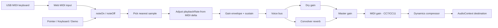
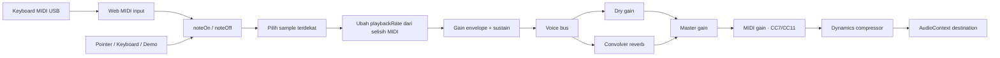

# GRAND / 88

[](https://ikyletwar.github.io/grand-piano-88/)
[](#english)
[](CREDITS.md)
[](#en-offline-mode--pwa)
[](#en-full-keyboard-map)

> **An 88-key grand piano in the browser.** Real Yamaha C5 recordings, sustain pedal, `Q`–`M` keyboard map with `Shift` for black keys, a realistic piano case UI, and full offline mode. No build step, no framework, no API, no analytics.

**[Live demo](https://ikyletwar.github.io/grand-piano-88/)** · **[Repository](https://github.com/Ikyletwar/grand-piano-88)** · **[Audio credits](CREDITS.md)**

<div align="center">

[🇬🇧 **English**](#english) · [🇮🇩 **Bahasa Indonesia**](#bahasa-indonesia)

</div>

---

<a id="english"></a>

## Table of contents

- [Overview](#en-overview)
- [Key features](#en-key-features)
- [Demo & access](#en-demo--access)
- [Quick start](#en-quick-start)
- [Full keyboard map](#en-full-keyboard-map)
- [MIDI input](#en-midi-input)
- [Complete controls](#en-complete-controls)
- [Technical architecture](#en-technical-architecture)
- [Audio engine](#en-audio-engine)
- [Offline mode & PWA](#en-offline-mode--pwa)
- [Project structure](#en-project-structure)
- [Responsiveness](#en-responsiveness)
- [Accessibility](#en-accessibility)
- [Performance](#en-performance)
- [Browser compatibility](#en-browser-compatibility)
- [Deployment](#en-deployment)
- [Troubleshooting](#en-troubleshooting)
- [License & attribution](#en-license--attribution)
- [Version history](#en-version-history)

---

<a id="en-overview"></a>

## Overview

This project is a static web app that turns the browser into an 88-key grand piano. Every sound comes from real **Salamander Grand Piano** samples — a Yamaha C5 recorded with two AKG C414 microphones by Alexander Holm and released under **CC BY 3.0**.

Three design principles drive the implementation:

1. **Real sound, not synthesis.** There is no oscillator-based piano. Thirty MP3 files are loaded and mapped onto 88 pitches with `AudioBufferSourceNode.playbackRate`.
2. **Controls that feel like an instrument.** Sustain, click-position velocity, light reverb, and immediate key response.
3. **No external dependency at play time.** A local sample mirror lives in the repo, a service worker caches everything, and CDNs are only fallbacks.

---

<a id="en-key-features"></a>

## Key features

### Instrument

- **Full 88 keys**, A0 to C8 — 52 white keys and 36 black keys.
- **Real grand piano samples**: Salamander Grand Piano, Yamaha C5, CC BY 3.0.
- **Sustain pedal** via the UI button or `Space`. While held, release extends from 240 ms to 1.8 s.
- **Dynamic velocity**: clicking near the bottom of a key produces a stronger attack; clicking near the pivot is softer.
- **Procedural reverb** built from a runtime-generated impulse response — no extra audio file.
- **Built-in demo**: the opening phrase of *Für Elise* followed by an A minor arpeggio, with automatic pedalling.

### Interaction

- **`Q`–`M` keyboard map** running left to right across the white keys.
- **`Shift` + letter** plays the matching black key.
- **Glissando**: press and drag the pointer across keys; the previous note is released and the new one triggered.
- **Multi-touch**: every pointer ID is tracked separately, so multi-finger chords work.
- **USB MIDI input**: a digital piano or controller becomes the keyboard; the sound still comes from the browser's Salamander samples.
- **Three view modes**: full 88 keys, 24 keys, and 12 keys.
- **Octave shift** moves the keyboard map by one octave per step.
- **Optional note labels**, including shortcut chips directly on the keys.

### Infrastructure

- **Pure static site**: `index.html`, `styles.css`, `app.js`, `sw.js`.
- **Offline-ready** via a service worker with 35 cache entries.
- **CDN fallback** to `tonejs.github.io` and `jsdelivr` if the local mirror fails.
- **Accessibility**: skip link, focus rings, `aria-keyshortcuts`, `aria-describedby`, `prefers-reduced-motion`.
- **Lighthouse**: Accessibility 1.00 · Best Practices 1.00 · SEO 1.00 · 0 failures.

---

<a id="en-demo--access"></a>

## Demo & access

| Need | Location |
|---|---|
| Live version | <https://ikyletwar.github.io/grand-piano-88/> |
| Source code | <https://github.com/Ikyletwar/grand-piano-88> |
| Audio credit & license | [`CREDITS.md`](CREDITS.md) |
| In-app keyboard guide | `?` button in the header, or press `?` |

GitHub Pages is active from branch `main`, path `/`, with HTTPS enforced.

---

<a id="en-quick-start"></a>

## Quick start

There is no dependency to install. All you need is a modern browser and a static server.

```bash
git clone https://github.com/Ikyletwar/grand-piano-88.git
cd grand-piano-88
python3 -m http.server 8080
```

Open <http://localhost:8080>.

Alternatives if Python is unavailable:

```bash
npx serve .
# or
php -S localhost:8080
```

> **Important:** opening `index.html` directly through `file://` still plays the piano, but the browser blocks `fetch` calls to local MP3 files. The app then falls back to the CDN and requires internet. For full offline use, run the local server or use GitHub Pages after the first visit.

---

<a id="en-full-keyboard-map"></a>

## Full keyboard map

Letters follow physical keyboard order: `Q` at the upper left, continuing to `P`, then down to `A`–`L`, then `Z`–`M`. `Q` is the leftmost white key in the active map; `M` is the rightmost white key in the active map.

### Default map — starting at C3

```text
White : Q  W  E  R  T  Y  U  I  O  P  A  S  D  F  G  H  J  K  L  Z  X  C  V  B  N  M
Note  : C3 D3 E3 F3 G3 A3 B3 C4 D4 E4 F4 G4 A4 B4 C5 D5 E5 F5 G5 A5 B5 C6 D6 E6 F6 G6
Black : ⇧Q ⇧E ⇧R ⇧T ⇧U ⇧I ⇧P ⇧A ⇧S ⇧F ⇧G ⇧J ⇧K ⇧L ⇧X ⇧C ⇧B ⇧N ⇧M
Note  : C#3 D#3 F#3 G#3 A#3 C#4 D#4 F#4 G#4 A#4 C#5 D#5 F#5 G#5 A#5 C#6 D#6 F#6 G#6
```

`⇧` means hold `Shift` before pressing the letter.

### Black-key rules

- For `C`, `D`, `F`, `G`, `A`: `Shift + letter` plays the black key **to the right**.
- For `E` and `B`: there is no black key to the right, so the one **to the left** is used (`D#` / `A#`).
- Some black keys can be triggered by two different `Shift` letters. For example, `Shift+W` and `Shift+E` both produce `D#3`; the chip shows the unique letter, but both combinations work.

### Octave shift

The `−` / `=` buttons or toolbar controls move the map start by one octave. Supported starting notes: `C1`–`C4`.

| Map start | `Q` | `M` |
|---|---|---|
| C1 | C1 · MIDI 24 | G4 · MIDI 67 |
| C2 | C2 · MIDI 36 | G5 · MIDI 79 |
| **C3 — default** | **C3 · MIDI 48** | **G6 · MIDI 91** |
| C4 | C4 · MIDI 60 | G7 · MIDI 103 |

When the map shifts, shortcut chips and key labels update with it.

---

<a id="en-complete-controls"></a>

## Complete controls

| Action | Input | Behavior |
|---|---|---|
| Play white keys | `Q` … `M` | Pitch rises in order to the right |
| Play black keys | `Shift` + letter | Maps to the nearest black key |
| Sustain | `Space` or Sustain button | Hold to keep released notes ringing |
| Velocity | Click position on the key | Pivot ≈ 0.48 · bottom edge ≈ 1.00 |
| Glissando | `pointerdown` + `pointermove` | Previous note is released, new note triggered |
| Multi-touch | Several fingers at once | Each pointer ID owns its own voice |
| Shift octave | `−` / `=` | One octave per step |
| Note labels | `` ` `` or Labels toggle | Show/hide note names + shortcuts |
| Reverb | Reverb toggle | Wet gain 0 ↔ 0.13 |
| Volume | Volume slider | Master gain 0–90 % |
| Key navigation | Focus piano area + `←` / `→` | Moves the focused key |
| Play focused key | `Enter` | Attack on press, release on release |
| View mode | 88 / 24 / 12 | Changes the number of rendered keys |
| MIDI input | **Hubungkan MIDI** button | Grants access; an external keyboard plays the browser samples |
| MIDI device / channel | MIDI input + Channel selects | All devices or one port; Omni or channels 1–16 |
| MIDI panic | **Panic** button | Releases every note that originated from MIDI |
| Demo | Play demo button | Plays the phrase; click again to stop |
| Help | `?` or `?` button | Opens the help panel |

---

<a id="en-technical-architecture"></a>

## Technical architecture



### Components

| File | Responsibility |
|---|---|
| `index.html` | Semantic markup, toolbar, help panel, attribution footer |
| `styles.css` | Wood case, ivory/black key geometry, active state, responsive layout, reduced-motion |
| `app.js` | Sample loader, Web Audio graph, input engine, voice manager, demo |
| `sw.js` | Precache + cache-first strategy for same-origin assets |
| `samples/` | 30 Salamander Grand Piano MP3 files |

No bundler, no framework, no third-party audio library. All logic runs in the browser.

---

<a id="en-audio-engine"></a>

## Audio engine

### Sample mapping

The Tone.js distribution of Salamander Grand Piano contains 30 MP3 files: `A0`–`A7`, `C1`–`C8`, `Ds1`–`Ds7`, and `Fs1`–`Fs7`. These samples sit at minor-third/octave intervals.

For every MIDI note 21–108, the app picks the nearest sample and computes:

```text
playbackRate = 2 ^ ((MIDI_target - MIDI_sample) / 12)
```

The maximum distance to the nearest sample is ±1.5 semitones, so pitch shifts stay natural without extreme stretching.

### Envelope and voices

| Parameter | Value |
|---|---|
| Attack | 6 ms, exponential ramp from 0.0001 to peak |
| Peak gain | `velocity ^ 1.25 × 0.95` |
| Release without pedal | 240 ms |
| Release with pedal | 1.8 s |
| Retrigger | Old voice released over 50 ms before the new voice starts |
| Dry gain | 0.96 |
| Wet gain | 0.13 when reverb is on |
| Master gain | `volume / 100 × 0.9` |
| Compressor | threshold −14 dB, knee 18, ratio 3, attack 4 ms, release 200 ms |

> **Honest detail about dynamics:** the original Salamander set has 16 velocity layers. The MP3 distribution used here provides one layer per pitch, so velocity controls gain rather than switching sample layers. This is a deliberate trade-off that keeps the total asset size around 2 MB and web-ready.

### Reverb

The impulse response is generated when the audio graph is created: two noise channels with exponential decay (`decay = 2.8`) over 1.7 seconds. No external IR file is used.

### Autoplay policy

The `AudioContext` is created on page load but may start as `suspended`. The first interaction — clicking a key, a button, or pressing a key — calls `resume()`. Clicking **Hubungkan MIDI** also resumes it inside a user gesture, so MIDI notes are audible immediately after permission is granted.

---

<a id="en-midi-input"></a>

## MIDI input

GRAND / 88 can use a **class-compliant USB MIDI keyboard** as its input device. Incoming note messages are played by the existing Salamander sample engine — the keyboard acts as a controller and the sound is produced in the browser. Nothing is sent back to the instrument.

### Requirements

- `https://` or `http://localhost` (secure context). The button is disabled on `file://` and plain LAN `http://`.
- Chrome/Chromium, Edge, or Firefox. Safari and iOS Safari do not implement Web MIDI (status as of 2026); the button is disabled and the rest of the piano keeps working.
- The keyboard may be connected before or after granting access — hot-plug is handled with `access.onstatechange`.
- `sysex: false`: no SysEx, no patch editing, no firmware access.

### Connecting

1. Connect the keyboard over USB, then click **Hubungkan MIDI** and accept the browser permission prompt. Chrome 124+ prompts for *all* MIDI access, not just SysEx. The same click resumes `AudioContext`, which satisfies the autoplay policy.
2. Wait for the header chip to read `MIDI aktif · <n> input`. If more than one port appears, pick the correct one in **MIDI input**.
3. Choose **Omni** or a specific MIDI channel. Changing the device or channel releases all notes from the previous route to prevent stuck notes.
4. Play. Velocity, sustain (CC64), pitch bend (±2 semitones), CC7/CC11 volume and CC120/121/123 panic are handled. Notes outside A0–C8 (21–108) are ignored.

### Voice ownership

Each voice remembers its origin (`pointer`, `keyboard`, `demo`, `click`, `enter`, `midi`). A note-off only releases a voice from the **same** origin, so holding `Q` and playing the same pitch on MIDI will not cut the `Q` voice — and vice versa. Keyboard sustain (CC64) and the UI `Space` pedal add together per channel. Notes are released on device disconnect, Panic, channel change, and tab hide.

### MIDI troubleshooting

| Symptom | Cause | Fix |
|---|---|---|
| **Hubungkan MIDI** is disabled | No Web MIDI or no secure context | Open the app via HTTPS or `localhost` in Chrome, Edge, or Firefox |
| Chip reads `MIDI: izin ditolak` | Permission declined | Re-enable MIDI in site settings, then click the button again |
| Chip reads `MIDI aktif · belum ada perangkat` | No port exposed by the OS | Connect the keyboard, check the USB cable, then reconnect |
| No sound from MIDI, but the key lights up | Notes arrive on a different channel | Set **Channel** to Omni or match the keyboard's transmit channel |
| Notes keep ringing | Device disconnected mid-note or channel changed | Press **Panic**; tracked MIDI voices are normally released automatically |
| CC7 changes level but the Volume slider does not move | Separate gain node | By design: CC7/CC11 drive a dedicated MIDI gain after the master fader |

---

<a id="en-offline-mode--pwa"></a>

## Offline mode & PWA

The `sw.js` service worker uses cache `grand-piano-88-v3` and precaches:

- `./` and `./index.html`
- `styles.css`
- `app.js`
- `sw.js`
- all 30 MP3 files in `samples/`

That is **35 cache entries**. The strategy is:

1. **Cache-first** for every same-origin GET request, including `HEAD` requests via `ignoreMethod: true`.
2. **Network fallback**: on a cache miss, the request goes to the network and a successful response is stored.
3. **Cross-origin skipped**: CDNs are not cached by the service worker; the browser's own cache still applies.
4. **Offline navigation**: if a `navigate` request fails, `index.html` is served from cache.

While offline, the header status changes to `Siap · 30 sample · offline`.

### Behavior by access method

| Access method | Fully offline? | Explanation |
|---|---|---|
| `http://localhost` via static server | Yes | All files are read directly from disk |
| GitHub Pages after first visit | Yes | The service worker has already filled the cache |
| GitHub Pages first visit without internet | No | HTML/JS/samples must be downloaded once |
| Direct `file://` | No | The browser blocks local file `fetch`; CDN is used |

To invalidate the cache after a code change, bump `CACHE_NAME` in `sw.js`. Old caches are removed automatically when the new worker activates.

---

<a id="en-project-structure"></a>

## Project structure

```text
grand-piano-88/
├── index.html      # Markup, controls, help panel, attribution footer
├── styles.css      # Piano case, key geometry, interaction states, responsiveness
├── app.js          # Audio engine, voice manager, input, demo, SW registration
├── sw.js           # Precache 35 assets + cache-first strategy
├── samples/        # 30 Salamander Grand Piano MP3 files (~2.0 MB)
│   ├── A0.mp3 … A7.mp3
│   ├── C1.mp3 … C8.mp3
│   ├── Ds1.mp3 … Ds7.mp3
│   └── Fs1.mp3 … Fs7.mp3
├── README.md       # This bilingual documentation
└── CREDITS.md      # Audio attribution and license
```

---

<a id="en-responsiveness"></a>

## Responsiveness

| Breakpoint | Behavior |
|---|---|
| ≥ 900 px | Default 88-key view; full case; key height ≈ 240–300 px |
| 720–899 px | 88 keys remain active; position slider appears if content overflows |
| < 720 px | Default 24 keys so touch targets stay large |
| ≤ 620 px | Toolbar wraps, case padding reduced, key height 208 px, smaller labels |

The 88-key mode remains available on narrow screens. Because the key area uses `touch-action: none` for glissando, horizontal navigation uses the **Key position** slider below the case rather than swiping on the keys.

No horizontal overflow was observed at 390 px, 768 px, or 1024 px.

---

<a id="en-accessibility"></a>

## Accessibility

- `skip-link` to the piano area for keyboard users.
- Buttons use semantic `<button>` elements with accessible names; `?`, `−`, and `+` icons are drawn with CSS to avoid `aria-label` conflicts.
- Every key exposes a matching `aria-keyshortcuts`, e.g. `Q` or `Shift+M`.
- The piano area uses `aria-describedby` pointing to the guide text.
- `:focus-visible` gives every interactive element a distinct accent outline.
- The help panel uses `aria-expanded` and `aria-controls`.
- `prefers-reduced-motion` disables transitions and the pressed-key transform.
- Text contrast follows the dark palette with a warm accent; Lighthouse accessibility = 1.00.

---

<a id="en-performance"></a>

## Performance

| Metric | Value |
|---|---|
| Sample size | ~2.0 MB for 30 MP3 files |
| Requests on load | 30 sample GETs + core assets |
| Parallel loaders | 6 concurrent workers |
| HEAD requests | 0 — per-file fallback goes straight to CDN |
| Visual assets | CSS gradients only; no decorative images |
| Animation | `transform` and `opacity` only; no layout thrash |
| After caching | 0 network requests for same-origin assets |

All samples load at startup to eliminate latency on the first key press. Progress is shown in the header until `Siap · 30 sample` appears.

---

<a id="en-browser-compatibility"></a>

## Browser compatibility

| Browser | Piano | MIDI input | Note |
|---|---|---|---|
| Chrome / Chromium | Supported | Supported (43+) | Full Web Audio + service worker; permission prompt since 124 |
| Edge | Supported | Supported (79+) | Chromium-based |
| Firefox | Supported | Supported (108+) | Full Web Audio + service worker |
| Safari macOS | Supported | **Not supported** | `AudioContext.resume()` runs on first gesture |
| Safari iOS | Supported | **Not supported** | 24-key view by default; navigation via position slider |
| `file://` | Limited | **Not supported** | Local samples blocked; CDN is used |

Service workers and Web MIDI only run on `https://` or `localhost`, per the web specification. When MIDI is unavailable the button is disabled with a tooltip; keyboard, pointer, and demo input are unchanged.

---

<a id="en-deployment"></a>

## Deployment

This project is already deployed to GitHub Pages:

```text
Repository : Ikyletwar/grand-piano-88
Branch     : main
Path       : /
Build type : legacy
URL        : https://ikyletwar.github.io/grand-piano-88/
```

To redeploy:

```bash
git add .
git commit -m "Describe your change"
git push origin main
```

GitHub Pages rebuilds automatically. For a custom domain, add a `CNAME` file at the repo root and set the domain under **Settings → Pages**.

---

<a id="en-troubleshooting"></a>

## Troubleshooting

| Symptom | Cause | Fix |
|---|---|---|
| No sound | `AudioContext` is still `suspended` | Click any key or button; the context resumes |
| `Sample tidak dapat diakses` status | Local mirror and CDNs both failed | Check the connection, then press **Try again** |
| Stuck at `Memuat sample …` | Slow network on first load | Wait; 30 files download in parallel |
| Keyboard does not respond | Focus is on a slider/input | Click an empty area or the piano first |
| `Space` activates a button instead of sustain | Focus is on another button | Click the piano or the Sustain button |
| 25th key missing in 24-key view | 26-letter map is longer than the view | Use 88-key view, or shift with `−` / `=` |
| 88-key view hard to pan on mobile | Touch on keys is reserved for glissando | Use the **Key position** slider |
| Offline fails under `file://` | Browser blocks local file `fetch` | Use the local server or GitHub Pages |
| Cache unchanged after update | Old cache version is still active | Bump `CACHE_NAME` in `sw.js` |
| MIDI button disabled | Safari/iOS or non-secure context | Use HTTPS/`localhost` in Chrome, Edge, or Firefox |
| MIDI permission denied | Prompt declined or revoked | Re-enable in site settings, then click **Hubungkan MIDI** |
| MIDI key lights up but no sound | Wrong channel, or samples still loading | Set Channel to Omni; wait for `Siap · 30 sample` |
| MIDI notes overlap with mouse/keyboard notes | Different voice origins on the same pitch | By design: first origin wins; release the first key or press **Panic** |

---

<a id="en-license--attribution"></a>

## License & attribution

### Audio

- Instrument: **Salamander Grand Piano V3**, Yamaha C5.
- Recording: **Alexander Holm**.
- Source: <https://freepats.zenvoid.org/Piano/acoustic-grand-piano.html>
- License: [Creative Commons Attribution 3.0 Unported](https://creativecommons.org/licenses/by/3.0/)
- MP3 distribution: <https://github.com/Tonejs/audio/tree/master/salamander>

This attribution must be preserved under CC BY 3.0 and is already shown in the app footer and in [`CREDITS.md`](CREDITS.md).

### Code

The application code was written specifically for this repository and imports no third-party audio library. No explicit code license has been set; all rights to the code remain with the repository owner.

---

<a id="en-version-history"></a>

## Version history

| Version | Change |
|---|---|
| 1.0.0 | Initial build: 88 keys, 30 Salamander samples, sustain, reverb, demo, 88/24/12 views |
| 1.1.0 | Keyboard map changed to `Q`–`M`; `Shift` for black keys; label toggle moved to backtick |
| 1.2.0 | Service worker, 35-asset precache, full offline mode, offline status, CDN fallback without HEAD request |
| 1.2.1 | Accessibility fixes for accessible names and bilingual extended documentation |
| 1.3.0 | Web MIDI input, source-aware voice ownership, per-channel sustain/pitch bend, MIDI panic, MIDI gain node, cache `v3` |

---

Built as a static web instrument: fast, predictable, and still usable without a connection after the first open.

---

<div align="center">

[🇬🇧 **English**](#english) · [🇮🇩 **Bahasa Indonesia**](#bahasa-indonesia)

</div>

<a id="bahasa-indonesia"></a>

## Bahasa Indonesia

> **Piano grand 88 tuts di browser.** Rekaman Yamaha C5 nyata, sustain pedal, peta keyboard `Q`–`M` dengan `Shift` untuk tuts hitam, tampilan case piano realistis, dan mode offline penuh. Tanpa build step, tanpa framework, tanpa API, tanpa analytics.

**[Versi live](https://ikyletwar.github.io/grand-piano-88/)** · **[Repository](https://github.com/Ikyletwar/grand-piano-88)** · **[Kredit audio](CREDITS.md)**

---

<a id="id-daftar-isi"></a>

## Daftar isi

- [Ringkasan](#id-ringkasan)
- [Fitur utama](#id-fitur-utama)
- [Demo & akses](#id-demo--akses)
- [Mulai cepat](#id-mulai-cepat)
- [Peta keyboard lengkap](#id-peta-keyboard-lengkap)
- [MIDI input](#id-midi-input)
- [Kontrol lengkap](#id-kontrol-lengkap)
- [Arsitektur teknis](#id-arsitektur-teknis)
- [Mesin audio](#id-mesin-audio)
- [Mode offline & PWA](#id-mode-offline--pwa)
- [Struktur proyek](#id-struktur-proyek)
- [Responsivitas](#id-responsivitas)
- [Aksesibilitas](#id-aksesibilitas)
- [Performa](#id-performa)
- [Kompatibilitas browser](#id-kompatibilitas-browser)
- [Deployment](#id-deployment)
- [Pemecahan masalah](#id-pemecahan-masalah)
- [Lisensi & atribusi](#id-lisensi--atribusi)
- [Riwayat versi](#id-riwayat-versi)

---

<a id="id-ringkasan"></a>

## Ringkasan

Proyek ini adalah static web app yang mengubah browser menjadi piano grand 88 tuts. Seluruh suara berasal dari sampel **Salamander Grand Piano**, rek grand piano Yamaha C5 yang direkam dengan dua mikrofon AKG C414 dan dirilis oleh Alexander Holm di bawah lisensi **CC BY 3.0**.

Tiga prinsip desain yang dipakai:

1. **Suara nyata, bukan synth.** Tidak ada oscillator piano tiruan. 30 file MP3 asli dimuat dan dipetakan ke 88 pitch memakai `AudioBufferSourceNode.playbackRate`.
2. **Kontrol yang terasa seperti instrumen.** Sustain, velocity berdasarkan posisi klik, reverb ringan, dan respons tuts yang langsung.
3. **Tidak bergantung pada layanan eksternal saat dipakai.** Mirror sample ada di repo, service worker menyimpan semuanya, dan CDN hanya menjadi cadangan.

---

<a id="id-fitur-utama"></a>

## Fitur utama

### Instrumen

- **88 tuts penuh**, A0 sampai C8 — 52 tuts putih dan 36 tuts hitam.
- **Sampel grand piano asli**: Salamander Grand Piano, Yamaha C5, CC BY 3.0.
- **Sustain pedal** lewat tombol UI atau `Space`. Saat pedal ditekan, release diperpanjang dari 240 ms menjadi 1,8 s.
- **Velocity dinamis**: klik dekat ujung bawah tuts menghasilkan serangan lebih keras, klik dekat pangkal lebih pelan.
- **Reverb prosedural** berbasis impulse response yang dibangkitkan di runtime — tidak ada file audio tambahan.
- **Demo bawaan**: frasa pembuka *Für Elise* diikuti arpeggio A minor, dengan pedal otomatis.

### Interaksi

- **Peta keyboard `Q`–`M`** berurutan dari tuts putih paling kiri ke kanan.
- **`Shift` + huruf** memainkan tuts hitam yang bersesuaian.
- **Glissando**: tekan dan geser pointer melintasi tuts; nada sebelumnya dilepas, nada baru dipicu.
- **Multi-touch**: setiap pointer ID dipantau terpisah, sehingga chord sentuh beberapa jari berfungsi.
- **Input MIDI USB**: piano digital / controller menjadi keyboard; suara tetap dari sample Salamander di browser.
- **Tiga mode tampilan**: 88 tuts penuh, 24 tuts, dan 12 tuts.
- **Octave shift** untuk memindahkan peta keyboard satu oktaf per langkah.
- **Label not opsional**, termasuk chip shortcut langsung di tuts.

### Infrastruktur

- **Static site murni**: `index.html`, `styles.css`, `app.js`, `sw.js`.
- **Offline-ready** lewat service worker dengan 35 entri cache.
- **CDN fallback** ke `tonejs.github.io` dan `jsdelivr` bila mirror lokal gagal.
- **Aksesibilitas**: skip link, focus ring, `aria-keyshortcuts`, `aria-describedby`, `prefers-reduced-motion`.
- **Lighthouse**: Accessibility 1,00 · Best Practices 1,00 · SEO 1,00 · 0 failure.

---

<a id="id-demo--akses"></a>

## Demo & akses

| Kebutuhan | Lokasi |
|---|---|
| Versi live | <https://ikyletwar.github.io/grand-piano-88/> |
| Source code | <https://github.com/Ikyletwar/grand-piano-88> |
| Kredit & lisensi audio | [`CREDITS.md`](CREDITS.md) |
| Panduan keyboard di aplikasi | Tombol `?` di header, atau tekan `?` |

Halaman GitHub Pages sudah aktif dari branch `main`, path `/`, dengan HTTPS enforced.

---

<a id="id-mulai-cepat"></a>

## Mulai cepat

Tidak ada instalasi dependency. Satu-satunya kebutuhan adalah browser modern dan server statis lokal.

```bash
git clone https://github.com/Ikyletwar/grand-piano-88.git
cd grand-piano-88
python3 -m http.server 8080
```

Buka <http://localhost:8080>.

Alternatif bila Python tidak tersedia:

```bash
npx serve .
# atau
php -S localhost:8080
```

> **Catatan penting:** membuka `index.html` langsung lewat `file://` tetap bisa memainkan piano, tetapi browser memblokir `fetch` ke file MP3 lokal. Aplikasi lalu memakai CDN dan memerlukan internet. Untuk offline penuh, pakai server lokal atau GitHub Pages setelah kunjungan pertama.

---

<a id="id-peta-keyboard-lengkap"></a>

## Peta keyboard lengkap

Urutan huruf mengikuti posisi fisik keyboard: `Q` di kiri atas, berlanjut ke `P`, turun ke `A`–`L`, lalu `Z`–`M`. `Q` adalah tuts putih paling kiri dalam peta aktif; `M` adalah tuts putih paling kanan dalam peta aktif.

### Peta default — mulai C3

```text
Putih : Q  W  E  R  T  Y  U  I  O  P  A  S  D  F  G  H  J  K  L  Z  X  C  V  B  N  M
Not   : C3 D3 E3 F3 G3 A3 B3 C4 D4 E4 F4 G4 A4 B4 C5 D5 E5 F5 G5 A5 B5 C6 D6 E6 F6 G6
Hitam : ⇧Q ⇧E ⇧R ⇧T ⇧U ⇧I ⇧P ⇧A ⇧S ⇧F ⇧G ⇧J ⇧K ⇧L ⇧X ⇧C ⇧B ⇧N ⇧M
Not   : C#3 D#3 F#3 G#3 A#3 C#4 D#4 F#4 G#4 A#4 C#5 D#5 F#5 G#5 A#5 C#6 D#6 F#6 G#6
```

`⇧` berarti tahan `Shift` sebelum menekan huruf.

### Aturan tuts hitam

- Untuk `C`, `D`, `F`, `G`, `A`: `Shift + huruf` memainkan tuts hitam **di sebelah kanan**.
- Untuk `E` dan `B`: tidak ada tuts hitam di kanan, maka yang dipakai adalah tuts hitam **di sebelah kiri** (`D#` / `A#`).
- Beberapa tuts hitam bisa dipicu oleh dua huruf `Shift` berbeda. Contoh: `Shift+W` dan `Shift+E` sama-sama menghasilkan `D#3`; chip di tuts menampilkan huruf yang unik, tetapi kedua kombinasi tetap berfungsi.

### Octave shift

Tombol `−` / `=` atau tombol di toolbar menggeser awal peta satu oktaf. Rentang awal yang didukung: `C1`–`C4`.

| Awal peta | `Q` | `M` |
|---|---|---|
| C1 | C1 · MIDI 24 | G4 · MIDI 67 |
| C2 | C2 · MIDI 36 | G5 · MIDI 79 |
| **C3 — default** | **C3 · MIDI 48** | **G6 · MIDI 91** |
| C4 | C4 · MIDI 60 | G7 · MIDI 103 |

Saat awal peta digeser, chip shortcut dan label di tuts ikut diperbarui.

---

<a id="id-kontrol-lengkap"></a>

## Kontrol lengkap

| Aksi | Input | Perilaku |
|---|---|---|
| Mainkan tuts putih | `Q` … `M` | Pitch naik berurutan ke kanan |
| Mainkan tuts hitam | `Shift` + huruf | Memetakan ke tuts hitam terdekat |
| Sustain | `Space` atau tombol Sustain | Tahan untuk menahan semua nada yang dilepas |
| Velocity | Posisi klik pada tuts | Pangkal ≈ 0,48 · ujung bawah ≈ 1,00 |
| Glissando | `pointerdown` + `pointermove` | Nada lama dilepas, nada baru dipicu |
| Multi-touch | Beberapa jari sekaligus | Tiap pointer ID memiliki voice sendiri |
| Geser peta oktaf | `−` / `=` | Satu oktaf per langkah |
| Label not | `` ` `` atau toggle Label not | Tampilkan/sembunyikan nama not + shortcut |
| Reverb | toggle Reverb | Mengubah wet gain 0 ↔ 0,13 |
| Volume | slider Volume | Master gain 0–90 % |
| Navigasi tuts | Fokus area piano + `←` / `→` | Memindahkan tuts yang difokuskan |
| Mainkan tuts fokus | `Enter` | Attack saat ditekan, release saat dilepas |
| Tampilan | 88 / 24 / 12 | Mengubah jumlah tuts yang dirender |
| Input MIDI | tombol **Hubungkan MIDI** | Memberi izin; keyboard eksternal memainkan sample browser |
| Perangkat / channel MIDI | select MIDI input + Channel | Semua perangkat atau satu port; Omni atau channel 1–16 |
| Panic MIDI | tombol **Panic** | Melepas semua nada yang berasal dari MIDI |
| Demo | tombol Putar demo | Memutar frasa; klik lagi untuk menghentikan |
| Panduan | `?` atau tombol `?` | Membuka panel bantuan |

---

<a id="id-arsitektur-teknis"></a>

## Arsitektur teknis



### Komponen

| File | Tanggung jawab |
|---|---|
| `index.html` | Struktur semantik, toolbar, panel bantuan, footer atribusi |
| `styles.css` | Case kayu, tuts gading/hitam, state aktif, layout responsif, reduced-motion |
| `app.js` | Loader sample, Web Audio graph, input engine, voice manager, demo |
| `sw.js` | Precache + cache-first untuk aset same-origin |
| `samples/` | 30 file MP3 Salamander Grand Piano |

Tidak ada bundler, tidak ada framework, tidak ada library audio pihak ketiga. Seluruh logika berjalan di browser.

---

<a id="id-mesin-audio"></a>

## Mesin audio

### Pemetaan sample

Salamander Grand Piano yang didistribusikan oleh proyek Tone.js berisi 30 sample MP3: `A0`–`A7`, `C1`–`C8`, `Ds1`–`Ds7`, dan `Fs1`–`Fs7`. Sampel-sampel ini diambil pada interval minor third/oktaf.

Untuk setiap MIDI note 21–108, aplikasi memilih sample dengan jarak pitch terdekat lalu menghitung:

```text
playbackRate = 2 ^ ((MIDI_target - MIDI_sample) / 12)
```

Selisih maksimal ke sample terdekat adalah ±1,5 semitone, sehingga perubahan pitch tetap terdengar alami tanpa stretching ekstrem.

### Envelope dan voice

| Parameter | Nilai |
|---|---|
| Attack | 6 ms, exponential ramp dari 0,0001 ke peak |
| Peak gain | `velocity ^ 1,25 × 0,95` |
| Release tanpa pedal | 240 ms |
| Release dengan pedal | 1,8 s |
| Retrigger | Voice lama di-release 50 ms sebelum voice baru |
| Dry gain | 0,96 |
| Wet gain | 0,13 saat reverb aktif |
| Master gain | `volume / 100 × 0,9` |
| Compressor | threshold −14 dB, knee 18, ratio 3, attack 4 ms, release 200 ms |

> **Detail tentang dinamika:** Salamander asli memiliki 16 velocity layer. Distribusi MP3 yang dipakai di sini menyediakan satu layer per pitch, sehingga velocity mengontrol gain, bukan pergantian layer sample. Ini trade-off yang disengaja agar total aset tetap ~2 MB dan siap dipakai di web.

### Reverb

Impulse response dibangkitkan saat audio graph dibuat: dua kanal noise dengan peluruhan eksponensial `decay = 2,8` selama 1,7 detik. Tidak ada file IR dari luar.

### Autoplay policy

`AudioContext` dibuat saat halaman dimuat, tetapi statusnya bisa `suspended`. Setiap interaksi pertama — klik tuts, tombol, atau keyboard — memanggil `resume()`. Klik **Hubungkan MIDI** juga me-resume konteks di dalam user gesture, sehingga note MIDI langsung terdengar setelah izin diberikan.

---

<a id="id-midi-input"></a>

## MIDI input

GRAND / 88 bisa memakai **keyboard MIDI USB class-compliant** sebagai perangkat input. Pesan note yang masuk dimainkan oleh mesin sample Salamander yang sudah ada — keyboard berperan sebagai controller, suara dihasilkan di browser. Tidak ada data MIDI yang dikirim kembali ke instrumen.

### Persyaratan

- `https://` atau `http://localhost` (secure context). Tombol dinonaktifkan di `file://` dan `http://` LAN biasa.
- Chrome/Chromium, Edge, atau Firefox. Safari dan iOS Safari belum mengimplementasikan Web MIDI (per 2026); tombol disabled dan piano tetap bisa dipakai.
- Keyboard boleh disambungkan sebelum atau sesudah izin diberikan — hot-plug ditangani lewat `access.onstatechange`.
- `sysex: false`: tanpa SysEx, tanpa edit patch, tanpa akses firmware.

### Cara menyambung

1. Hubungkan keyboard lewat USB, klik **Hubungkan MIDI**, lalu terima prompt izin browser. Chrome 124+ meminta izin untuk *semua* akses MIDI, bukan hanya SysEx. Klik yang sama juga me-resume `AudioContext`, sehingga memenuhi kebijakan autoplay.
2. Tunggu chip di header berbunyi `MIDI aktif · <n> input`. Bila lebih dari satu port tampil, pilih yang benar di **MIDI input**.
3. Pilih **Omni** atau channel MIDI tertentu. Mengganti perangkat/channel melepas semua nada dari rute lama agar tidak ada stuck note.
4. Mulai bermain. Velocity, sustain (CC64), pitch bend (±2 semitone), volume CC7/CC11, dan panic CC120/121/123 didukung. Note di luar A0–C8 (21–108) diabaikan.

### Kepemilikan voice

Setiap voice menyimpan asalnya (`pointer`, `keyboard`, `demo`, `click`, `enter`, `midi`). Note-off hanya melepas voice dari **asal yang sama**, jadi menahan `Q` lalu memainkan pitch yang sama lewat MIDI tidak akan memotong voice `Q` — dan sebaliknya. Sustain keyboard (CC64) dan pedal `Space` di UI bersifat aditif per channel. Nada dilepas saat perangkat terputus, Panic, pergantian channel, dan saat tab disembunyikan.

### Pemecahan masalah MIDI

| Gejala | Penyebab | Solusi |
|---|---|---|
| Tombol **Hubungkan MIDI** disabled | Tidak ada Web MIDI atau bukan secure context | Buka lewat HTTPS atau `localhost` di Chrome, Edge, atau Firefox |
| Chip `MIDI: izin ditolak` | Izin ditolak | Aktifkan lagi di pengaturan situs, lalu klik tombol lagi |
| Chip `MIDI aktif · belum ada perangkat` | Tidak ada port yang terlihat OS | Sambungkan keyboard, cek kabel USB, lalu sambung ulang |
| MIDI tidak bersuara, tapi tuts menyala | Note masuk di channel lain | Set **Channel** ke Omni atau samakan dengan channel kirim keyboard |
| Nada terus berbunyi | Perangkat terputus saat note ditahan atau channel berubah | Tekan **Panic**; voice MIDI normalnya dilepas otomatis |
| CC7 mengubah level, slider Volume tidak bergerak | Node gain terpisah | Memang by design: CC7/CC11 mengendarai gain MIDI khusus setelah fader master |

---

<a id="id-mode-offline--pwa"></a>

## Mode offline & PWA

Service worker `sw.js` memakai cache `grand-piano-88-v3` dan melakukan precache terhadap:

- `./` dan `./index.html`
- `styles.css`
- `app.js`
- `sw.js`
- 30 file MP3 di `samples/`

Total **35 entri cache**. Strateginya:

1. **Cache-first** untuk semua request GET same-origin, termasuk request `HEAD` berkat `ignoreMethod: true`.
2. **Network fallback**: bila tidak ada di cache, request diteruskan ke jaringan dan respons sukses disimpan.
3. **Cross-origin dilewati**: CDN tidak dicache oleh service worker; browsers cache bawaan tetap berlaku.
4. **Navigasi offline**: bila request mode `navigate` gagal, aplikasi mengembalikan `index.html` dari cache.

Saat status offline, label di header berubah menjadi `Siap · 30 sample · offline`.

### Perilaku berdasarkan cara akses

| Cara akses | Offline penuh? | Penjelasan |
|---|---|---|
| `http://localhost` lewat server statis | Ya | Semua file dibaca langsung dari disk |
| GitHub Pages setelah kunjungan pertama | Ya | Service worker sudah mengisi cache |
| GitHub Pages kunjungan pertama tanpa internet | Tidak | Perlu mengunduh HTML/JS/sample sekali |
| `file://` langsung | Tidak | `fetch` ke file lokal diblokir; CDN dipakai |

Untuk memperbarui cache setelah perubahan kode, naikkan versi `CACHE_NAME` di `sw.js`. Versi lama otomatis dihapus saat service worker baru aktif.

---

<a id="id-struktur-proyek"></a>

## Struktur proyek

```text
grand-piano-88/
├── index.html      # Markup, kontrol, panel bantuan, atribusi footer
├── styles.css      # Case piano, geometri tuts, state interaksi, responsivitas
├── app.js          # Audio engine, voice manager, input, demo, SW registration
├── sw.js           # Precache 35 aset + strategi cache-first
├── samples/        # 30 MP3 Salamander Grand Piano (~2,0 MB)
│   ├── A0.mp3 … A7.mp3
│   ├── C1.mp3 … C8.mp3
│   ├── Ds1.mp3 … Ds7.mp3
│   └── Fs1.mp3 … Fs7.mp3
├── README.md       # Dokumentasi ini
└── CREDITS.md      # Atribusi dan lisensi audio
```

---

<a id="id-responsivitas"></a>

## Responsivitas

| Breakpoint | Perilaku |
|---|---|
| ≥ 900 px | Tampilan default 88 tuts; case piano penuh; tinggi tuts ~240–300 px |
| 720–899 px | 88 tuts tetap aktif; slider posisi muncul bila konten melebihi lebar |
| < 720 px | Default 24 tuts agar tuts cukup besar untuk sentuhan |
| ≤ 620 px | Toolbar wrap, case padding dipangkas, tinggi tuts 208 px, label diperkecil |

Mode 88 pada layar sempit tetap tersedia. Karena area tuts memakai `touch-action: none` untuk glissando, navigasi horizontal memakai slider **Posisi tuts** di bawah case, bukan swipe pada tuts.

Tidak ada horizontal overflow pada 390 px, 768 px, maupun 1024 px saat diuji.

---

<a id="id-aksesibilitas"></a>

## Aksesibilitas

- `skip-link` ke area piano untuk keyboard user.
- Tombol memakai elemen `<button>` semantik dengan nama aksesibel; ikon `?`, `−`, dan `+` dibuat via CSS agar tidak bentrok dengan `aria-label`.
- Setiap tuts memiliki `aria-keyshortcuts` yang sesuai, misalnya `Q` atau `Shift+M`.
- Area piano memiliki `aria-describedby` yang merujuk ke teks panduan.
- `:focus-visible` memberi outline aksen pada semua elemen interaktif.
- Panel bantuan memakai `aria-expanded` dan `aria-controls`.
- `prefers-reduced-motion` menonaktifkan transisi dan transform tuts yang ditekan.
- Kontras teks mengikuti palet gelap dengan aksen hangat; Lighthouse accessibility = 1,00.

---

<a id="id-performa"></a>

## Performa

| Metrik | Nilai |
|---|---|
| Ukuran sample | ~2,0 MB untuk 30 MP3 |
| Request saat load | 30 GET sample + aset inti |
| Parallel loader | 6 worker konkuren |
| Request HEAD | 0 — fallback per file langsung ke CDN |
| Aset visual | CSS gradient; tidak ada gambar dekoratif |
| Animasi | `transform` dan `opacity` saja; tidak ada layout thrash |
| Setelah cache | 0 request jaringan untuk aset same-origin |

Sample dimuat semua saat startup agar tidak ada latency pada tuts pertama. Status progress ditampilkan di header hingga `Siap · 30 sample`.

---

<a id="id-kompatibilitas-browser"></a>

## Kompatibilitas browser

| Browser | Piano | MIDI input | Catatan |
|---|---|---|---|
| Chrome / Chromium | Didukung | Didukung (43+) | Web Audio + service worker penuh; prompt izin sejak 124 |
| Edge | Didukung | Didukung (79+) | Berbasis Chromium |
| Firefox | Didukung | Didukung (108+) | Web Audio + service worker penuh |
| Safari macOS | Didukung | **Tidak didukung** | `AudioContext.resume()` dipanggil pada gesture pertama |
| Safari iOS | Didukung | **Tidak didukung** | Mode 24 tuts default; geser memakai slider posisi |
| `file://` | Terbatas | **Tidak didukung** | Sample lokal diblokir; CDN dipakai |

Service worker dan Web MIDI hanya aktif di `https://` atau `localhost`, sesuai spesifikasi web. Saat MIDI tidak tersedia, tombol di-disabled dengan tooltip; input keyboard, pointer, dan demo tetap normal.

---

<a id="id-deployment"></a>

## Deployment

Proyek ini sudah di-deploy ke GitHub Pages:

```text
Repository : Ikyletwar/grand-piano-88
Branch     : main
Path       : /
Build type : legacy
URL        : https://ikyletwar.github.io/grand-piano-88/
```

Untuk deploy ulang:

```bash
git add .
git commit -m "Deskripsi perubahan"
git push origin main
```

GitHub Pages akan membangun ulang otomatis. Bila memakai custom domain, tambahkan file `CNAME` di root repo lalu set domain di **Settings → Pages**.

---

<a id="id-pemecahan-masalah"></a>

## Pemecahan masalah

| Gejala | Penyebab | Solusi |
|---|---|---|
| Tidak ada suara | `AudioContext` masih `suspended` | Klik tuts atau tombol apa pun; konteks akan di-resume |
| Status `Sample tidak dapat diakses` | Mirror lokal dan CDN gagal | Cek koneksi, lalu tombol **Coba lagi** |
| Status macet di `Memuat sample …` | Jaringan lambat saat first load | Tunggu; 30 file diunduh paralel |
| Keyboard tidak merespons | Fokus berada di slider/input | Klik area kosong atau area piano dulu |
| `Space` mengaktifkan tombol, bukan sustain | Fokus berada di tombol lain | Klik area piano atau tombol Sustain |
| Tuts ke-25 tidak tampil di mode 24 | Peta 26 huruf lebih panjang dari tampilan | Pakai mode 88, atau geser peta dengan `−` / `=` |
| Mode 88 sulit digeser di HP | Sentuhan pada tuts dipakai untuk glissando | Pakai slider **Posisi tuts** |
| Offline tidak berfungsi di `file://` | Browser memblokir fetch file lokal | Pakai server lokal atau GitHub Pages |
| Cache tidak berubah setelah update | Versi cache lama masih aktif | Naikkan `CACHE_NAME` di `sw.js` |
| Tombol MIDI disabled | Safari/iOS atau bukan secure context | Pakai HTTPS/`localhost` di Chrome, Edge, atau Firefox |
| Izin MIDI ditolak | Prompt ditolak atau dicabut | Aktifkan di pengaturan situs, lalu klik **Hubungkan MIDI** |
| Tuts MIDI menyala tapi tidak bersuara | Channel salah atau sample masih dimuat | Set Channel ke Omni; tunggu `Siap · 30 sample` |
| Note MIDI tumpang tindih dengan mouse/keyboard | Voice dari asal berbeda pada pitch sama | Memang by design: asal pertama menang; lepas tuts pertama atau tekan **Panic** |

---

<a id="id-lisensi--atribusi"></a>

## Lisensi & atribusi

### Audio

- Instrumen: **Salamander Grand Piano V3**, Yamaha C5.
- Rekaman: **Alexander Holm**.
- Sumber: <https://freepats.zenvoid.org/Piano/acoustic-grand-piano.html>
- Lisensi: [Creative Commons Attribution 3.0 Unported](https://creativecommons.org/licenses/by/3.0/)
- Distribusi MP3: <https://github.com/Tonejs/audio/tree/master/salamander>

Atribusi ini wajib dipertahankan sesuai CC BY 3.0 dan sudah tampil di footer aplikasi serta di [`CREDITS.md`](CREDITS.md).

### Kode

Kode aplikasi ditulis khusus untuk repository ini dan tidak mengimpor library audio pihak ketiga. Belum ada lisensi kode eksplisit yang ditetapkan; seluruh hak atas kode melekat pada pemilik repository.

---

<a id="id-riwayat-versi"></a>

## Riwayat versi

| Versi | Perubahan |
|---|---|
| 1.0.0 | Build awal: 88 tuts, 30 sample Salamander, sustain, reverb, demo, mode tampilan 88/24/12 |
| 1.1.0 | Peta keyboard diganti ke urutan `Q`–`M`; `Shift` untuk tuts hitam; toggle label dipindah ke backtick |
| 1.2.0 | Service worker, precache 35 aset, offline penuh, status offline, fallback CDN tanpa request HEAD |
| 1.2.1 | Perbaikan aksesibilitas nama aksesibel dan README dokumentasi lengkap |
| 1.3.0 | Input Web MIDI, kepemilikan voice per sumber, sustain/pitch bend per channel, panic MIDI, node gain MIDI, cache `v3` |

---

Dibuat sebagai static web instrument: cepat, dapat diprediksi, dan tetap berfungsi tanpa koneksi setelah pertama kali dibuka.
